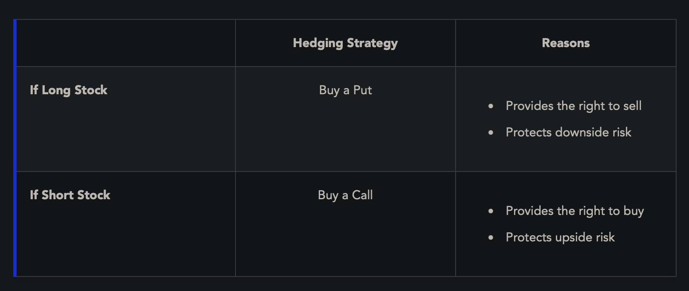

**Option**: A derivative security thats price is based off the price of an underlying stock, index, currency, or other asset
- Has 2 parties, the buyer/owner/holder and the seller

**Buyer**: pays the option's premium (the contract's market price) - *long* the option, receives right to exercise the contract
- Depending on the type of option, they have the right to either buy or sell the underlying security
- If option expires worthless, the premium is the buyer's max loss

**Seller**: Receives the options premium and assumes obligations if contract is exercised - *short* the option
- If option expires worthless, the premium is the seller's maximum gain

**Call Option**: Gives the owner the right to BUY underlying security at a fixed price
- Buyers of calls are bullish (want the price to go up, and they can buy at lower price)
- Sellers of calls are bearish (want the price to go down so they can make a profit)

**Put Option**: Gives the owner the right to SELL underlying security at a fixed price
- Buyers of puts are bearish
- Sellers of puts are bullish

**Components**
- **Security**: the underlying security, typically right to buy/sell 100 shares of it
- **Expiration Month**: The month of expiry, when it ceases to exist (3rd Friday of this month)
- **Exercise (Strike) Price**: The price in which the owner may buy/sell
- **Type**: Call or Put
- **Premium**: The market price of the option, represented in points ($ per share), multiply by 100 to find the total price paid to buy option contract
	- Changes value in secondary market when contract is bought/sold. Affected by underlying stock price, time to expiry, volatility

**Option Premium** = Intrinsic value (amount **IN** the money) + time value (higher if longer expiry)

**Speculation**: Buying options to make profit based on anticipated price changes for a security one doesn't own

**Hedging**: Purchasing options to protect against risk of adverse movement of price in a security one already owns

**Option Events**
- **Liquidate/Trade/Close-out**: 
- **Exercise**: Executing the buy/sell of the underlying security
	- **American Style** = may be exercised at any time up to the day on which they expire, all equity options are American style
	- **European Style** = may only be exercised at a specific point in time (usually day of expiry), prevalent w/ index and currency options
	- If a buyer exercises an option, the seller must fulfill their obligation
		- For equity option calls, this means delivering 100 shares of the stock at agreed upon strike price regardless of current market value (or opposite for puts)
	- Steps to exercise, takes 1 business day for equity options (T + 1)
		- *Buyer's Exercise*: buyer notifies broker-dealer of their intent to exercise
		- *Broker dealer notifies OCC*
		- *OCC will randomly issue the exercise notice to a broker dealer that has the opposite position*
		- *The broker-dealer that receives the notice will select a client to whom to assign the notice (random, FIFO, etc.)*
- **Expire**: If an option is at or out of the money, there is no point in exercising it, thus buyers will let it expire
	- Options expire on the 3rd Friday of the expiration month at 11:59PM ET
	- Buyer must notify by 5:30 PM ET that day if they choose to exercise
	- Options stop trading at 4:00 PM ET that day

**Options Clearing Corporation (OCC)**: Organization that guarantees all listed options
- Built to avoid possibility of option sellers being unable to fulfill their obligations

**Options Disclosure Document**: The document issues to customers who open options account by member firms - details description of options, risk, terminology, etc.

**Index Options**: Options against indexes like the S&P 500
- Settled in **cash** that represents the amount the option is in the money instead of buying/selling equity

**Hedging w/ Options**

**Covered Call**: Selling a call while owning the underlying security (loss capped)
**Uncovered Call**: Selling a call without owning underlying security (price may rise an infinite amount)

**Covered Put**: The seller of the put must either be short the underlying stock or deposit cash equal to strike price. If they don't deposit the right amnt of cash, its an uncovered put.