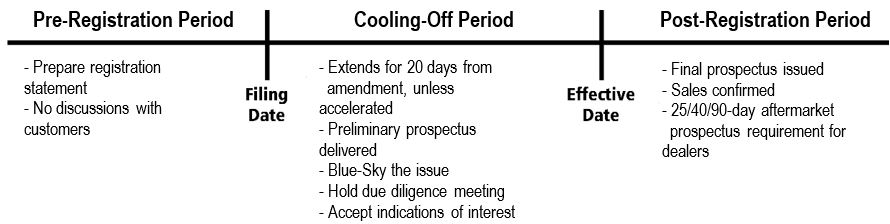
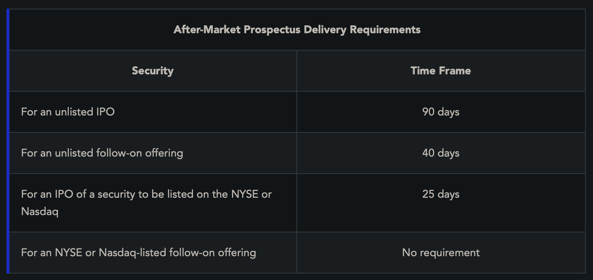

Offerings happen to raise capital by selling stocks/bonds.

**Public Offering**: Offering securities to public investors. Benefit is larger pool of investors, downside is more regulatory cost.

**Private Placements**: Institutional investors providing capital to corps. Faster, and less costly. Limits who can participate though.

**IPO**: The first public offering vs. **Follow-on offering**: any additional offering after the company has gone public (still considered *primary distributions* -> offering in which proceeds are paid to issuer)

*FINRA rules say firms must disclose in trades if they have any financial interest, such as in IPO or follow on offerings*

**Combined (Split) Offering**: Mix of some shares offered by issuer (primary distribution), some offered by shareholders (they receive proceeds, not issuer). Underwriter must disclose to purchasers that a portion will be paid to shareholders (senior officers etc.)

**Underwriter**: A broker-dealer that helps corps/municipalities that want to raise capital.
- An IB acting as underwriter may buy the new issues and resell
- An *underwriting syndicate* is a group of BDs conducting a public offering

**Firm Commitment (Acting as Principal)**: When a syndicate purchases entire offering and agrees to absorb any unsold securities.

**Best Efforts (Acting as Agent)**: When a syndicate agrees to sell as much of new offering as they can. They find purchasers, so they act in the capacity of an agent. Unsold securities are returned to issuer.
- Under **contingency**, if minimum required shares aren't sold, offering will be cancelled. (_best-efforts-all-or-none_)
- **Mini-maxi**: setting a minimum and maximum range for offering

**Standby**: Syndicate agrees to buy any shares not purchased by existing stockholders in rights offering

**Market Out Clause**: Clause that allows syndicate to cancel offering if some events happen

**Shelf Registration**: Allows issuer to sell additional securities on delayed/continuous basis (only allowed for amount that may be reasonably sold in 3 years).

BD that wants to be syndicate must do due diligence on issuer and issue before starting.

**Selling Group**: BDs that help assist in distribution - no financial liability, just sales agents
- Shares not sold are retained by the syndicate
- To join, a *selling group agreement* must be signed

**Pricing**: For a IPO, underwriters take into account various factors (earnings, similar companies etc) and price it at a fixed price. For subsequent offerings, it is usually a slight discount of market price.

**Underwriting Spread**: Difference between amount paid by investing public and amount received by issuing corporation
- Managers fee paid to managing underwriter
- Members/underwriters fee paid to syndicate members
- Concession paid to firm that sells the share (*takedown* = underwriters fee + concession)

**Payments for Market Making**: If a BD acts as a market maker on the secondary market after an offering, the issuer may not compensate them for doing so (for publishing quotes, being market maker etc.) - they still may be paid for real service

**Registration**
**Pre Registration**
- Issuer prepares registration statement
- Underwriter may help, but cannot speak about issue with customers
- Underwriter does due diligence
- Issuer files registration statement with SEC (this statement helps investors make informed decision)
	- Contains info about character of business, balance sheet, financial statements etc.
	- Prospectus also shared w/ investors
	- This is not guaranteed truthful, accurate or complete by SEC

**Cooling Off Period**: 20 days waiting period - SEC reviews registration and determines if its complete and not misleading, if it is, it sends a deficiency letter

**Preliminary Prospectus (Red Herring)**: Prospectus sent to potential buyers, has red text (red herring) indicating it has been submitted to SEC but not yet declared effective. Final offering price is not included, just range.
- During cooling off period, underwriters may not accept payment for new issue in advance or sell the new issue. They CAN discuss it and take down potential buyers names
- Prospectus may not be altered 

**State/Blue-sky Laws**: Issuers must also satisfy state requirements to register issue there.
- Notification: submitting application to state administrator
- Coordination: Filing form simultaneously with federal registration
- Qualification: Meeting specific state requirements, wait for approval of state administrator

**Due Diligence**: Meeting with syndicate and issuers before effective date to discuss all aspects of registration and planned underwriting

**Effective Date**: The end of the cooling off period, generally 20 days after the filing or after the last amendment in response to a deficiency letter
- Once effective, public offering price (POP) is set. Sales can begin and purchases must be provided with final prospectus. Electronic delivery is fine.

For some securities, propsectuses must still be given out after offering is over, for a limited time:

In a **_preliminary prospectus** (red herring)_, the following information can be omitted:
- The offering price of the issue
- The underwriting discounts (or commissions) and discounts to dealers
- The amount of proceeds to be received by the issuer
- Conversion rates or call prices
- Other matters that are dependent on the offering price

This **summary prospectus** is often only three to four pages long and must include:
- Investment objective
- Costs
- Principle investment strategies, risks, and performance
- Name of investment adviser, as well as the name, title, and length of service of up to five portfolio managers
- Purchase (including minimum purchase amounts), redemption, and tax information
- Financial intermediary compensation information

**Free Writing Prospectus (FWP)**: Still filed with SEC but doesn't include everything a statutory prospectus needs. Includes things like press releases, web pages, videos. Used after formal registration is filed.

**Offering Memorandum**: Used for private placements, since no registration needs to be filed with SEC for private placements.

