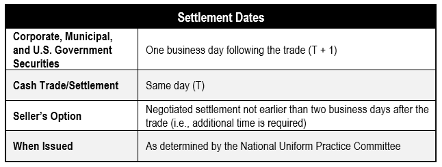
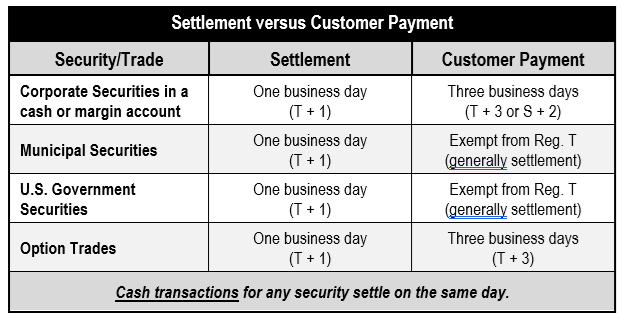

**Trade Lifecycle**
- **Order Entry –** The placing of a trade into the system either using either a print or electronic ticket
- **Execution –** The occurrence of a trade or fill in the secondary market (i.e., on the NYSE or Nasdaq)
- **Clearing –** Agreement by executing firms as to the details of a trade
- **Settlement –** The swapping of securities for funds that completes the transaction between firms
- **Custody and Safekeeping –** The safeguarding of client and firm assets after settlement

**Settlement Dates**

**Customer Payment Dates**

Rules are established by FINRA's Uniform Practice Code

**Settlement Methods**
- **DTCC Settlement**: adjusts security positions and cash balances of contra-parties in its internal books electronically (**Book-Entry Settlement**), settlement is guaranteed by DTCC
- **Book-Entry Settlement**: electronic settlement rather than physical exchange of cerificates
	- All depository eligible securities must be settles through a registered securities depository such as DTCC or NSCC (National Securities Clearing Corp)
	- Depository eligible securities are those that may be transferred through book keeping entries
- **Paper Settlement**: Physical delivery of securities, they must have
	- *CUSIP Numbers*: bar codes for securities
	- *Endorsements and assignments*: A signature on the certificate by the customer who is selling
	- *Units*: 
		- for stock transactions, certificates must be in multiple of 100 shares (for a sale of 500 shares, you can do 1 500 share certificate or 5 100 share certificates but not 2 250 share certificates)
		- for bonds, they must be in multiples of $1000, no denomination larger than 100k
- **Restricted Securities**    As mentioned in Chapter 11, securities that carry a restrictive legend are not considered to be in good delivery form. Generally, these certificates must have the legend removed, which is the responsibility of the selling firm. Only a transfer agent has the authority to remove a restrictive legend. However, the transfer agent will not remove the legend unless the client has obtained the consent of the issuer in the form of an _opinion letter_ that’s created by the issuer’s counsel. The process of cleaning the certificate (removing the legend) is typically accomplished under Rule 144.

**Stock Splits (Forward Splits)**: Usually dont to reduce price of stock to make it more marketable
- Company issues more shares at specific ratio and stock's par value is adjusted accordingly
- Market usually reacts favorably but theres no immediate change in value
- Either even (2 for 1, 3 for 1) or odd (3 for 2, 5 for 4) splits
- To calculate new shares owned, multiply shares by ratio, to calculate new price, multiply price by inverse of ratio
- When stock split is recorded but before shares land in account, a due bill is attached to all trades promising the buyer that the seller will send over extra shares once they receive them

**Reverse Stock Split**: Opposite of forward split

There is no tax impact of stock splits or stock dividends, the owner just needs to adjust their cost basis

**Tender Offer**: A pubic offer that indicates intent to buy a specific stock at a fixed price to take control of the company or get a board seat
- An investor may participate if they own a stock or equivalent security such as convertible security, warrant or right
	- convertible security, warrant or right will only convert if tendered and accepted
- Has entered an unconditional contract to buy the stock but has yet to receive it
- Owns a call option and exercised the option
	- Must exercise before participating

*Odd Lot Tenders*: When a company has a lot of shareholders who have odd lots (those with less than a full round lot), this causes administrative costs when dealing with them - they may create a tender offer to buy up odd lots

**Mergers and Acquisitions**: Mergers are if 2 companies combine, an acquisition is if one buys the other

**Spinoff**: One company separating from the other

**Official Communications**: Firms handle keeping securities safe in bearer form, book-entry form etc. In many cases, securities are held in *street-name* (in the name of the broker-dealer) to facilitate transfers. While its in this form, the customer is considered the **beneficial owner** of the security. The issuer may or may not know the name of the beneficial owners
- Broker-dealers must make a reasonable effort to re-transmit official communication from issuer, trustee, or state/federal taxing authority to the beneficial owners

**Beneficial Owner**: Person with securities positions that are being held with a financial intermediary, typically registered in street name
- The issuer of the security may not know the breakdown of who owns each stock (If Robinhood owns 15 million ABC shares, ABC doesn't know if a certain person owns X amount of that stock)
- **Non-Objecting Beneficial Owner (NOBO)**: a beneficial owner that consents to sharing their name and ownership with the issuer
	- they receive direct communications, proxies and financial filings 
- **Objecting Beneficial Owner (OBO)**: does not consent to sharing name/ownership with issuer
	- The broker-dealer will re-distribute communications to them in this case
	- They must also distribute proxies (giving someone else permission to vote for them in a vote for the corporation)

**Forms 10-K and 10-Q**: annual and quarterly reports, must be forwarded

**Charging Issuers for Services**    A member firm may charge _issuers_ for forwarding materials to the beneficial owners. The reimbursement rates are standardized under FINRA rules

**Charging Customers for Services**    A member firm may also charge its _customers_ for services, including safekeeping of securities, collection of dividends and interest, and exchange or transfer of securities. However, the charges must be reasonable and cannot unfairly discriminate between customers.
- Cannot charge for forwarding reports, proxies etc since the issuer pays for that part