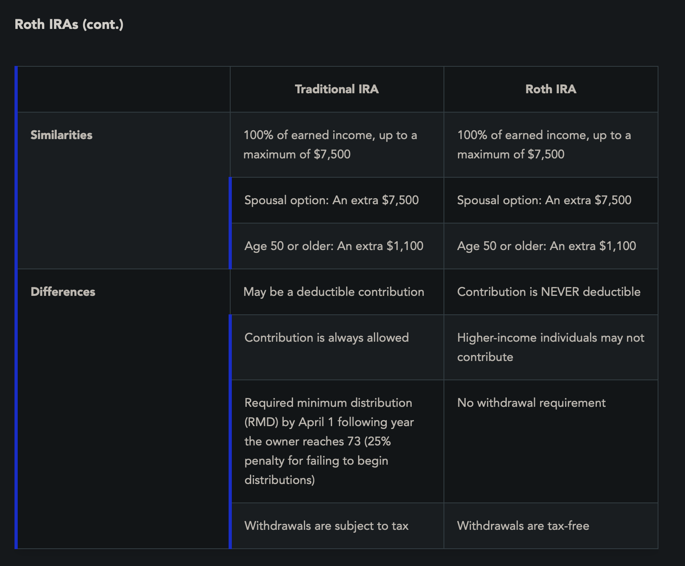

**Cash Accounts**: a type of brokerage accountt where the investor is required to pay full amount for any securities being purchased, not allowed to borrow funds from broker-dealer
- firms usually require payment by settlement date or risk interest
- Reg T requires payment by S + 2

**Margin Accounts**: an account where broker-dealer lends money to customer to buy securities
- broker-dealer holds securities as collateral 

**Traditional Individual Retirement Accounts (IRAs)**: Funded directly by owner
- Any person, regardless of age who has earned income from employment may contribute EARNED INCOME (not including interest, dividends, capital gain etc) -> only wages/salaries etc.
- Under certain conditions, IRA contributions are tax deductible, but income earned by money invested in an IRA accumulates on a tax deferred basis until its withdrawn
- NO MARGIN allowed, Must designate beneficiary 
- Can be invested in many different things but not life insurance, art etc. The owner must pick what to invest in

**Contribution Limits**: $7,500 or 100% of earned income, whatever is less, per year
- Overpayment leads to 6% tax penalty, individuals >=50 years of age are allowed a $1,100 catch up contribution 

**Spousal Accounts**: Married couples with only 1 spouse working may contribute $15,000 annually (into 2 separate IRAs, the non working spouses account is called a spousal account)

You can deduct IRA contribution from taxable income provided you dont contribute to employer sponsored retirement plan (same if you have a spousal account, neither may contribute). If you do, then the amount you can deduce depends on your income

**Transfers**: Transferring funds from one IRA to another is not taxable, you may do it as much as you wish

**Rollovers**: One may rollover contributions from a qualified retirement plan like a 401k into an IRA without incurring taxes, but may only be done once every 12 rolling months, and must be done within 60 days.

**Early Withdrawals from IRA**: Withdrawing money before age 59.5 will make you pay a 10% tax penalty on the amount withdrawn UNLESS:
- The account owner becomes _disabled_
- The account owner _dies_ and the money is withdrawn by the beneficiary
- The money is used to pay certain _medical expenses_ that are not covered by insurance or _medical insurance premiums_ when the owner is unemployed
- The money is used for expenses related to _being a qualified first-time home buyer_ ($10,000 limit)
- The money is used for expenses related to the _birth or adoption_ of a child ($5,000 limit)
- The money is used to pay _qualified higher education expenses_ (including tuition, fees, books, and room and board) for the account holder or a member of her immediate family
- The withdrawals are set up as a series of _substantially equal periodic payments_ that are taken over the owner’s life expectancy

**Required Minimum Distributions (RMDs)**: You must withdraw before April 1 following the year in which you turn 73 or else you pay a 25% tax penalty (depending on how much should have been taken)

**Roth IRA**: Like an IRA, but not tax deductible, paid with after tax dollars
- Can withdraw contributions at any time
- Can withdraw earnings tax free IF:
	- The account owner is age 59 1/2 or older
	- The account owner has died or become disabled
	- The money is used for qualified first-time home buyer expenses ($10,000 lifetime limit)
	- The money is used for expenses related to the birth or adoption of a child ($5,000 limit)
	- The money is used to cover certain medical expenses or medical insurance premiums
	- The money is used to pay for qualified higher education expenses
- If they dont meet above conditions, they pay 10% tax on earnings and income tax on earnings
Contributions: same as IRA
Eligability: Anyone can do so as long as they meet income limits, employer sponsored plan doesn't matter for Roth IRA

**Employee Retirement Income Security Act (ERISA)**: Created to prevent misuse/mismanagement of pension fund plans. Plans receive favorable tax treatment if they qualify by:
1. _Eligibility Requirements_ The plan must cover all employees who are age 21 or older and have worked for the employer for at least one year. For purposes of determining full-time employment, working 1,000 hours or more during the year equates to full-time.
2. _Vesting_ This is the schedule under which employees’ rights to receive the benefits contributed to a plan by their employers gradually become guaranteed based on their years of service. At a minimum, all participants must be either fully vested after five years or 20% vested after three years with full vesting after seven years of service. However, employees are always 100% vested in the contribution they have made to a plan on their own behalf.
3. _The Investment of Contribution and Determination of Benefits_ The investment of plan assets, as well as other plan activities, is governed by strict fiduciary guidelines.

If they follow these rules, plans will have:
- Pre tax contributions
- Tax deferred growth
- Non-discrimination (cannot discriminate in favor of high earning employees)

With all of this, they will get tax breaks for contributions the EMPLOYER makes
Plans can either be defined benefit or defined contribution (either company promises how much they will pay or let it be on the employee)