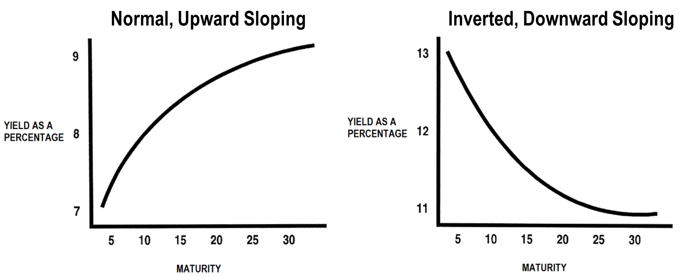
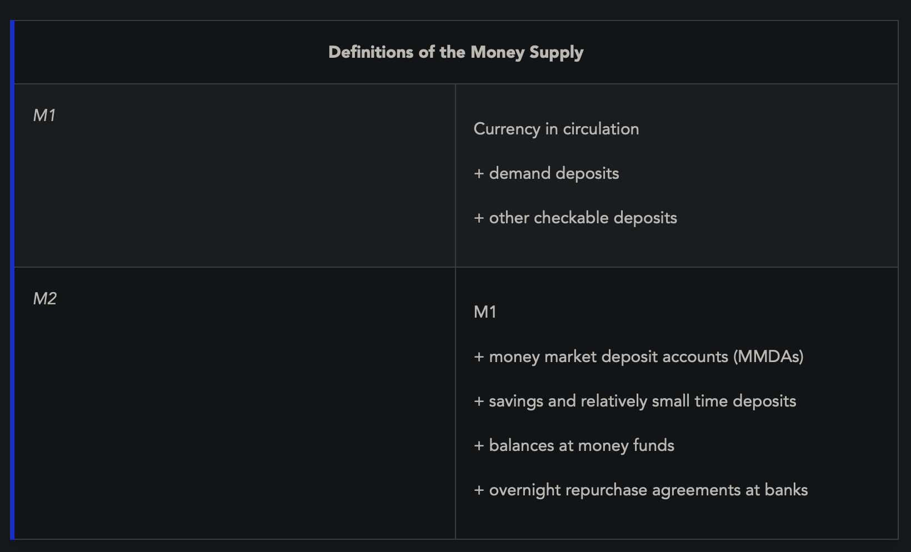
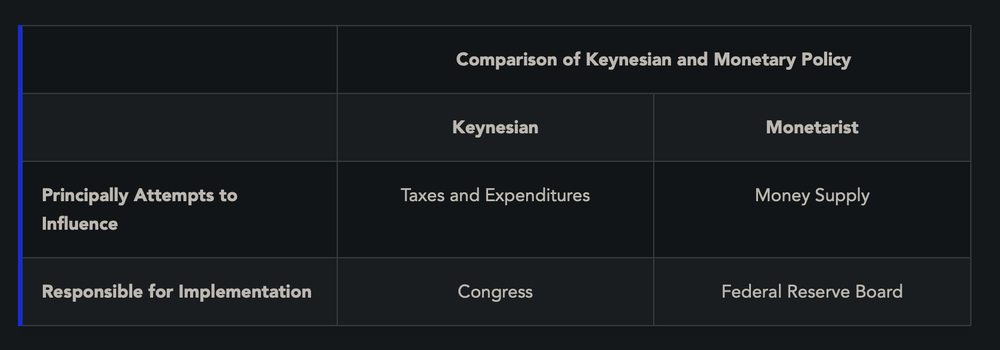

**Gross National Product (GNP)**: Total value of all goods and services being produced by a national economy (including goods and services produced overseas by a company of that nation)

**Gross Domestic Product (GDP)**: Value of all goods and services produced in that country
- includes consumer spending, investments, government spending, and net exports
- *Real GDP*: GDP adjusted for inflation using constant dollars

**Balance of Payments**: how economists measure the payments coming into and going out of a country
- Current account: balance of trade for the year
- Capital account: net changes in ownership of assets

**Inflation**: persistent and appreciable rise in the general level of prices
- happens when demand for goods/services outpaces supply

**Consumer Price Index (CPI)**: measures the prices of a fixed basket of goods that are bought by typical consumers. Index for inflation. 

Inflationary periods are typically characterized by rising interest rates. Bonds, interest-rate-sensitive stocks, such as those issued by utilities and financial service companies, also have significant reactions to changes in interest rates (declines with increasing rate)

**Equities as an Inflation Hedge**: Equity products are conventionally good inflation hedges. Products that provide fixed payments regardless of inflation are more susceptible to inflation risk

**Commodities as an Inflation Hedge**: Commodities, such as gold and silver, tend to perform well during inflationary periods.

**Fixed-Income Investors Fear Inflation**: fixed-income securities are more vulnerable to inflation
- rising interest rates will cause the market prices of their holdings to fall
- the purchasing power of their interest payments will decrease
If higher rates are anticipated, bond investors will make adjustments to shorten their maturities (i.e., decrease portfolio duration) in order to minimize the effect of downward pricing pressure. Some bondholders may also attempt to protect their portfolios by purchasing inflation-indexed bonds, such as Treasury Inflation Protected Securities (TIPS).

**Real Interest Rate** = Yield of bond - inflation rate
- The actual return of a bond subtracting inflation

**Deflation**: persistent and appreciable decline in the general level of prices
- more supply than demand

**The Business Cycle**: Expansion and Contraction (Recovery and Recession)
- Expansion: business activity is growing, production and demand are increasing, and employment is expanding, money is borrowed, interest rates are increased
- Peak: demand for goods begins to overtake supply. Since consumers have a large amount of available funds to use for pursuing a limited amount of goods, prices begin to rise, thereby creating inflation.
- Contraction: prices rise, demand goes down, layoffs etc, lowered interest rates to improve economy
- Recession = 2 successive quarters of negative Real GDP growth

**Indicators**
- **Leading** (precede movements of the cycle)
	- Average weekly hours, manufacturing
	- Average weekly initial claims for unemployment insurance
	- Manufacturing new orders, consumer goods and materials
	- ISM Index of New Orders (this reflects the level of new orders from customers)
	- Manufacturers’ new orders, non-defense capital goods excluding aircraft orders
	- Building permits, private housing units
	- The prices for the S&P 500 Index common stocks
	- Leading Credit Index (This index consists of six financial indicators based on various yields)
	- Interest-rate spreads, 10-year Treasury bonds less federal funds
	- Average consumer expectations for business conditions
- **Coincident** (mirror the movements of the business cycle)
	- Employees on non-agricultural payrolls
	- Personal income less transfer payments (Transfer payments represent aid for individuals in the form of Medicare, Social Security, and veterans’ benefits, etc.)
	- The Index of Industrial Production
	- Manufacturing and trade sales
- **Lagging** (items that change after the economy has moved through a stage)
	- Average duration of unemployment
	- Ratio of manufacturing and trade inventories to sales
	- Change in labor cost per unit of output for manufactured goods
	- The average prime rate charged by banks
	- Commercial and industrial loans outstanding
	- Ratio of consumer installment credit to personal income
	- Change in the Consumer Price Index for services
**Interest-Rate Changes**: affect bondholders the most. from lowest to highest:
- **Federal Funds Rate** The fed funds rate is what’s charged on an overnight loan of reserves between member banks.
- **Discount Rate** The discount rate is what the depository institutions are charged when they borrow from the Federal Reserve.
- **Call Rate** The call rate is what commercial banks charge on collateralized loans to broker-dealers (for margin purposes).
- **Prime Rate** The prime rate is what commercial banks charge their best corporate clients.

**Price Elasticity of Demand**: how much a items demand is affected by price (soda has high elasticity since ppl buy less if its expensive, gas is inelastic since people need it anyways)

**Types of Stocks**
- **Cyclical Stocks**: Stocks that follow business cycles
	- e.g machining, construction, transportation, basic industries.
	- things affected by new orders of development
- **Defensive Stocks**: have a smaller reaction to changes in the business cycle than cyclical stocks
	- usually things that people need to live, regardless of how the economy is doing
	- utilities, pharma, alcohol/tobacco, food
- **Growth Stocks**: companies whose sales and earnings are growing at a faster rate than the overall economy
	- they usually dont pay dividends and they re-invest their earnings
	- riskier
	- high PE ratio (stock’s current market price is divided by its earnings per share) and low dividend payout ratio (dividends per share being paid to shareholders is divided by the earnings per share)
- **Value Stocks**
	- one that tends to trade at a lower price relative to the issuing company’s fundamentals and is therefore considered undervalued by a value investor
	- tend to have high dividend yields, low price-to-book ratios, and/or low price-to-earnings ratios
- **Market Capitalization** (total number of outstanding common shares is multiplied by its current price)
	- Large cap: >$10 billion
	- Mid cap: $2 - $10 billion
	- Small cap: $300m - $2 billion
	- Micro cap: $50m - $300m
	- Nano cap: <$50m
		- usually low price-per-share and are extremely volatile and risky.

**Keynesian Theory**: government intervention is necessary to keep economy growing

**Fiscal Policy**: Government can increase spending and decrease taxes to raise demand or decrease spending and increase taxes to curb demand
- set by the President and Congress (may make political, not economic decisions). the Treasury implements fiscal policy, it doesn’t have direct control over it. Conversely, monetary policy is controlled by the Federal Reserve—a body that’s theoretically independent of the political process.

**Monetary Policy**: attempts to control the supply of money and credit in the economy. adjustments will affect interest rates and cause an increase or decrease in economic activity
- Managed by the FED
- Easing = lowering interest rates and increasing supply of money (stimulate economy)
- Tightening = raising interest rates and decreasing supply (reduce activity, inflation)

**Yield Curves**

Easy money (declining interest rates)                   Tight money (increasing interest rates)

**Money Supply**

## FRB Tools
**Reserve Requirements**: Member banks must keep portion of deposits on reserve with FRB
- Reserve requirement lowered = banks can lend more credit
	- Increases money supply and decreases interest rates
- Reserve requirements increased = banks lend less
	- Decreases money supply and increases interest rates
- Amount bank has above required reserve is called excess reserves
	- Multiplier effect = rate at which banks can create new money by re-lending deposits

**Discount Window**
- FRB can lend money to banks through its discount window. It sets the discount rate and can raise and lower it to discourage or encourage borrowing
	- When banks borrow money, new money is injected and multiplied through multiplier effect

**Federal funds**: Short term loans of excess reserves that banks lend to one another
- Overnight loans, very volatile, rate published daily
- FRB sets a target/range for fed funds rate

**Open Market Operations**: _Federal Open Market Committee_ _(FOMC)_ buys and sells US government securities on secondary market (like T bills, notes and bonds)
- Buying securities -> FRB pays money to banks -> reserves increase -> more funds available -> easing
- Selling securities -> FRB gets money -> reserves decrease -> less funds available -> tightening -> less inflation
- **Repurchase Agreements**: either buying or selling but with an agreement to reverse transaction (usually w interest payment), used if effect is only wanted for short term

**Margin Requirements**: The FRB can increase or decrease margin requirements to modify how much banks can extend to purchase securities, tightening or loosening money supply
- Only affects securities market transactions

**Moral Suasion**: Using public media or examiners sent to banks to persuade them to control money supply in a certain way

Increasing money supply can be inflationary - decreasing money supply can be deflationary

**Exchange Rates**:
- Spot rate = current value of a base currency compared to another currency/asset
- If US interest rates are higher than rest-of-world, investors will put money into US dollar investments, increasing demand for dollar and increasing its dollar value

Trade deficit = more in than out -> to correct this, weaken dollar to make US goods more competitive

Trade surplus = more out than in -> to correct this, strengthen dollar to make consumers able to buy more from abroad

**Fundamental Analysis**: Analyzing the company and industry (financial statements, companies products, staff etc)

**Technical Analysis**: Making decisions based on market data, price trends, patterns

**Balance sheet**: Represents financial picture of a company as of a specified date
- 3 Major sections: Assets, liabilities, stockholders' equity (net worth)
- Assets = Liabilities + stockholders equity

**Assets**:
- **Current assets**: Cash and other items that can be converted to cash within a year (marketable securities, accounts receivable, inventories)
- **Fixed Assets**: Items used by company in day-to-day operations to create products (physical property, land, equipment)
- **Intangible Assets**: assets without physical value (patents, IP, trademarks)
	- Goodwill = amount above market value paid to acquire company

**Liabilities**:
- **Current Liabilities**: debts that become due in <1 year (identified by word payable, like accounts payable, dividends payable, interest payable, taxes payable)
- **Long-term Liabilities**: Debts incurred that become payable in >1 yr

**Stockholders Equity**: Represents companies net worth, indicated shareholders ownership interest
- Different classes of stock, retained earnings, capital surplus (amount of premium above the par value that’s paid by investors who purchase the shares from the issuing corporation)

**Income Statement**: Profit and loss statement during a specified period
- **Sales (revenues)**: total money received and amounts billed (yet not collected) from companys primary source of business
- **Operating expenses**: daily costs of doing business including depreciation of fixed assets
- **Operating income** = **Sales (revenue)** - **Operating expenses**
- **EBIT (earnings before interest expense and taxes)** = **Operating income** + other forms of income and expenses (such as investment income, or asset sales etc.)
- **Net income/loss** = **EBIT** - bond interest - taxes
- **EBIDTA**: earnings before interest expense, taxes, depreciation and amortization

**Measuring Profitability**: operating profit margin is used to measure profitability
- operating profit margin = net operating income / sales
- bond coverage ratio = EBIT (EBITDA) / interest expense