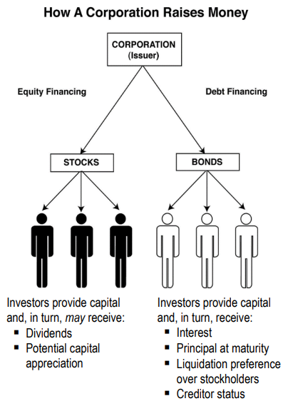

**Corporation**: like a person, can be sued, can sue, buy/sell property, get loans. many businesses organize themselves as them to reduce their liability, as any individual shareholder is not liable for a corporations full debts (they can only lose their %)

Shareholders of the company elect a board of directors (BOD) and this board is responsible for overseeing the company and appointing its senior managers.

**Raising Money**: either issue debt securities (bonds) - they provide no ownership/voting rights OR issue equity securities, which represent a % of ownership and voting rights

If the corporation is forced to liquidate its assets under Chapter 7 bankruptcy, bondholders and other creditors have a higher claim to the company’s assets and will be paid first.

**Common Stock**: Last to be paid if corporation declares bankruptcy. may receive dividends, but only after bondholders receive interest and preferred stockholders receive dividends
- Basic unit of corporate ownership
- Most widely issued type of stock
- First type of stock that a corporation issues

**Preferred Stock**: Above common stock in dividend payment and bankruptcy but below bondholders

In both Chapter 7 and Chapter 11 bankruptcy proceedings, the corporation’s secured creditors have the highest claim. Administrative claim holders are paid next, followed by unsecured creditors, then are preferred stockholders, and the last to receive payments are common stockholders.

**Authorized Shares**: When incorporated, a company can authorize a set number of shares that can't be changed without a majority vote and changes to the charter. Usually companies issue fewer shares than authorized to give them wiggle room

**Issued Shares**: Shares that have been sold

**Treasury Stock**: Issues shares that were bought back, no voting rights, no dividends

**Outstanding Stock**: Issued stock - Treasury stock. Basically all of the stock the public has that receives dividends and voting share. Outstanding stock * stock price = market cap

**Rights of shareholders**
- **Right of inspection**: right to inspect certain books and records of the company (usually annual report)
- **Right to vote**: may attend annual shareholder meetings and vote on important issues (cannot vote on dividend payments though, that is for BOD)
	- Different classes of common stock may have different voting rights (class A vs class B)
	- **Statutory Voting**: number of shares = number of votes per issue
	- **Cumulative Voting**: number of shares * number of issues = number of votes can allocate any issue(s)
- **Right to receive dividends**
- **Right to evidence of ownership**: right to receive one or more stock certificates as proof of ownership, must have name of the corporation, the name of the owner, and the number of shares that are owned by the stockholder AND name of registrar and transfer agent
- **Right of transfer**: right to sell, give away, transfer shares that are not restricted (pre IPO, employee compensation etc)

**Restricted Securities**: Stock can have a lock up period where it cant be sold (for ex. pre ipo) - it has a restricted legend across its certificate

**Rule 144** regulates the sale of _restricted_ securities and _control_ (affiliated) securities
- Restricted: unregistered securities, Acquired by investors through private placements
- Control (affiliated): registered securities, Acquired by officers, directors, or other insiders (10%+ share) and family members of such in secondary market
- **Holding Period**: restricted securities must be held for 6 months after they are fully paid for

**Classifications**
- **Blue chip stocks**: Major companies with long records of earnings and dividend payments - stable companies with financial strength
- **Growth stocks**: a company whose sales, earnings, market share is expanding faster than average economy/industry - aggressive companies, don't pay dividends, mostly reinvest their money
- **Defensive stocks**: resistant to recession - necessary services (utilities), consumer staples (tobacco, pharma, soda, food)
- **Income stocks**: Stocks that pay out good dividends (utility stocks are here too)
- **Cyclical stocks**: Companies whose earnings fluctuate w/ business cycle (stuff like household appliances, steel, construction, cars)
- **American Depositary Receipts (ADRs)**: an ADR represents a claim to a foreign security while the actual shares are held by US banks located overseas - traded in US markets and priced in US dollars
	- Sponsored ADR = company who underlies the stock pays depository banks to issue ADR shares in the US (allows company to raise capital in the US), listed on NASDAQ/NYSE
	- Unsponsored = bank does it themselves, trades on OTC markets, not NASDAQ or NYSE

**Preferred stock**: lack voting rights, issues with par value of $100 and carries specified dividend (unlike common stock). Dividend may be % of par or dollar value
- Dividend is still optional, dividend states is MAX dividend that may be paid out

**Cumulative Preferred Stock**: Feature of preferred stock. If a full dividend isn't paid out, all owed dividends that weren't paid up accumulate and must be paid out before common stockholders receive any dividends.
**Non cumulative** is the opposite of the above, no requirement to pay out missed dividends.

**Participating Preferred Stock**: Holder may receive additional % dividend on top of max dividend if company does well and common dividends exceed certain amount.

**Callable Preferred Stock**: Company can repurchase (call the stock) at specified price at some time in the future (holder gets paid). Call price is usually high

**Convertible Preferred Stock**: You can convert par value of preferred stock into certain amount of common stock. Par ($100) / Conversion price = amount of common stock received.
- Usually lower dividend value 

**Rights**: Issued to existing common stockholders allowing them to buy additional shares to keep their percentage of ownership when more shares are being issued.
- Usually below market value
- short term maturity (30-45 days)

**Warrants**: Derivative that give holder the ability to buy issuers common stock for specified *subscription price* at some specified date in the future
- Have a maturity often set years in future, some have perpetual life
- Usually, subscription price is set above current market price
- May be sold separately from security but usually issued to purchasers of stocks/bonds
- If stocks value is above subscription price, the warrant has *intrinsic value* 

**FINRA Rule 2261 – Disclosure of Financial Condition**: If a customer asks, firm must disclose its financial condition to them

**FINRA Rule 2262 – Disclosure of Control Relationship with Issuer**: A brokerage firm that has a control relationship with the issuer of any security must disclose to customer. Disclosure must be provided either before or at time of executing transaction (this happens when firm is publicly traded or subsidiary of publicly traded company)

**SEC Rule 10b-18 – Purchases of Certain Equity Securities by the Issuer**: Limits how an issuer can purchase its own stock to avoid price manipulation
- **Safe Harbors Under 10b-18**: SEC wont think you're trying to manipulate stock prices if you:
	- Only use one broker-dealer to place bids/purchases in any trading session
	- Don't trade in last 30 mins (or last 10 mins if its actively traded) of day, and dont make first trade of that day
	- Bid/purchase price may be max of last transaction price or highest current bid price
	- The amount of stock purchased in a day is limited, you volume may not exceed 25% of the avg daily trading volume for that security 
