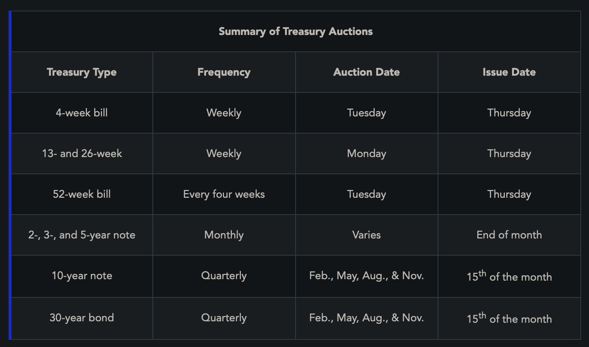
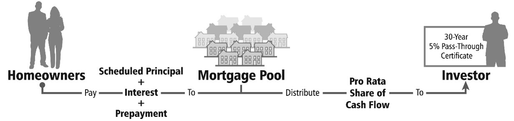

**Marketable**: aka Negotiable, traded in secondary markets after issuance (treasury securities)

**Non-marketable**: aka non-negotiable, purchased and redeemed directly w/ US government (US savings bonds)

**T-Notes and T-Bonds**: Standard fixed-income investments.
- Receive face value at maturity and pay interest semiannually, maturities of 2-10 years for notes, and 10+ years for bonds
- Interest is federally taxed only

**Treasury Inflation-Protected Securities (TIPS)**
- Interest bearing, marketable
- Rate of interest is fixed, but principal tracks change in CPI (but not below $1000)
- Issues in book-entry form in $100 increments, available in 5, 10 and 30 year terms
- Interest is taxed federally only

**Treasury bills (T-bills)**: Short term securities that mature in <= 1year (maturities of 4, 6, 8, 13, 17, 26, and 52 weeks)
- Always sold at a discount from their face value
- No interest payments, maturity payment represents interest
- Prices are quoted on discounted yield basis, price means how much of a discount you're getting (percentage wise, on par)

**Treasury STRIPS**: No interest payments, just one lump sum - track T-notes and T-bills underlying
- Bought by broker-dealers and resold without interest payments
- Quoted on yield basis

**Cash Management Bills (CMBs)**: Short term (sometimes a day) maturity used to smooth out Treasury cash flows
- Offered at discount but mature at face amount

Treasuries are sold through auctions

**Agency Securities**: Debt intstruments issued/guaranteed by federal agencies and government sponsored enterprises
- Still very low credit risk
- Slightly higher yields
- quoted in fractions of 1/32nds of a point

**Federal Agencies**: Fully guaranteed by US government (including Government National Mortgage Association)

**Government Sponsored Enterprises**: publicly charted but private orgs. Enterprises issue securities by giving proceeds to a bank or other lender, then the bank lends money to person seeking financing
- Federal Farm Credit Banks
	- Banks for Cooperatives, Intermediate Credit Banks, and Federal Land Banks
	- Agricultural loans for farmers
	- Interest is only federally taxes
- Federal Home Loan Banks
	- Provide loans for savings/loan institutions to help meet seasonal demands for money
	- Subject to only federal tax

**Mortgage Backed Securities**: Debt instruments secured by pools of home mortgages
- Agencies that issue them:
	- _Government National Mortgage Association (GNMA_ or _Ginnie Mae)_
		- provides financing for residential housing
		- fully backed by US government, operates within US dept of housing
		- fully taxable
		- issues modified pass through certificates: fully guaranteed even if mortgages aren't paid
		- **prepayment risk**
	- _Federal National Mortgage Association (FNMA_ or _Fannie Mae)_
		- raises money to buy insured Federal Housing Administration (FHA), Veterans Administration (VA), and conventional residential mortgages from lenders
		- backed by its authority to borrow from US Treasury
		- Interest is fully taxable
	- _Federal Home Loan Mortgage Corporation (FHLMC_ or _Freddie Mac)_
		- Provides funds to federally insured savings institutions to finance new housing through pass through certificates, mortgage backed bonds etc
		- Not backed by US government, backed by corporations and mortgages
		- Interest earned is Fully taxable

**Pass Through Certificates**: Security that gives you a share of cashflow from a mortgage poolEvery month, homeowners make payments and then payments are passed through to investors

**Municipal Bonds**: Bonds issued by states, territories etc (even school districts, counties, cities).
- Carry some default risk
- Interest is exempt from federal tax, and if buying in-state, exempt from state tax

**General Obligation Bonds (GO bonds)**: General purpose bonds, issued to meet any and all needs of issue
- Only issued by issuer with taxing power, **must be voted on**
- Backed by taxes on things
- May have **debt ceiling**, max debt it can take on

**Revenue Bonds**: Issued for projects/enterprise financing where issuers pledges to repay bondholders with revenue generated by project
- May be issues by governments, authority or commission created to issue bonds for project
- Can finance airports, hospitals, bridges etc.
- Generally considered riskier than GO bonds because future revenue may be unreliable
- Can also use leases to pay bondholders
- Must have **feasibility study** done -> consulting engineer and accounting firm assess whether project is valid

**Types of Revenue Bonds**:
- **Housing Revenue Bonds**: Bonds issued by housing agencies to fund housing for low/moderate income families
- **Dormitory Bonds**: Student housing at universities
- **Health Care Revenue Bonds**: Construction of hospitals
- **Utility Revenue Bonds**: Used to finance gas, water, sewer, electricity systems owned by governmental unit.
	- Backed by user fees charged to customers
	- If revenue isn't enough, payments could come from revenue and general obligation of municipality (double barreled)
- **Transportation Bonds**: Bridges, tunnels, toll roads, airports, transit, uses user fees to pay
- **Special Tax Bonds**: backed by special taxes (e.g., taxes on tobacco, gasoline, hotel/motel stay) for a specific project (not property tax)
- **Special Assessment Bonds**: payable only from a specific charge on those who directly benefit from the facilities (e.g bonds that are issued to develop water/sewer systems)
- **Moral Obligation Bonds**: first secured by revenues of project, then the state (or a state agency) is morally obligated (but not legally required) to provide the needed funds. _legislative approval_ is required beforehand
- **Lease Rental Bonds**: Entity leases facility to someone else, revenue generated from lease
- **Private Activity Bonds**: If more than 10% of funds are used for financing private project and more than 10% of bonds proceeds are secured by property used in the private entitys business
	- Industrial Development Bond: Secured by lease agreement by corporation
- **Taxable Municipal Bonds**: Bonds not exempt from federal tax (if they dont benefit the general public enough)
- **Double Barreled bonds**: Paid from revenues of project and full faith of the bond issuer

**Municipal Notes**: Short term issues to assist in financing project or managing cash flow
- **Tax Anticipation Notes (TANs)**: Used to finance municipal obligations in anticipation of future property tax receipt
- **Revenue Anticipation Notes (RANs)**: Issued in anticipation of future revenues 
- **Tax and Revenue Anticipation Notes (TRANs)**: When both TAN and RAN are issued together
- **Bond Anticipation Notes (BANs)**: Issued to obtain financing for projects that will eventually be financed by long term bonds 
- **Grant Anticipation Notes (GANs)**: anticipates future grants from government
- **Construction Loan Notes (CLNs)**: issued to provide funds for construction project that will be funded by bond issue

**Ratings (best to worst)**:
Moody's: MIG 1, MIG 2, MIG 3, SG
S&P: SP 1+, SP 1, SP 2, SP 3

**Auction Rate Securities**: Municipal security. either long term bond or preferred share w cash dividend
- Long term, but at frequent intervals, interest rate/dividend payout is reset through auction
- set through Dutch auctions for a specified short period that’s usually measured in days

**Variable Rate Demand Obligations** (VRDO): Long term security that's interest rate is adjusted at frequent periodic dates, where owner can sell it back or not

**Municipal Securities are exempt from registration - rules governed by MSRB**

**New Issue Underwritings**:
- **Role of Underwriter**: Assists issuer in pricing, structuring and preparing disclosure doc
- **Selection**:
	- *Negotiated Sale*: Issuer goes directly to underwriter they want, discuss details during negotation
	- *Competitive Sale*: Issuer takes bids, best offer wins
- U.S. government securities – Auction process
- Municipal general obligation bonds – Competitive sale
- Municipal revenue bonds – Negotiated sale
- Corporate bonds – Negotiated sale
Usually, multiple BDs combine to form underwriting syndicate to share risk
Municipal issues are usually sold on a firm commitment basis, so underwriters are responsible for selling whole issue.

**Corporate Bonds**: Issues to fund corporate developments
- Corporations dont have to give up ownership, but they are obligated to pay debt service
- Interest must be paid on bonds before dividends are paid out to shareholders
- Don't offer as much capital appreciation

**Secured Bonds**: Backed by specific asset, if company defaults trustee with take possession of assets, liquidate them and pay back secured bondholders 
- **Mortgage Bonds**: Secured by first or second mortgage on real property (backed by house)
- **Equipment Trust Certificates**: Secured by specific piece of equipment owned and used by company (like transportation companies trains and planes etc)
- **Collateral Trust**: Secured by 3rd party stocks/bonds
- **Asset Backed Securities (ABS)**: Loans offered by banks etc are sometimes securitized and offered to lenders (like credit cards, home equity, car loans)
	- High yield, secured, predictable cash flow
	- Credit risk, interest rate risk and prepayment risk

**Unsecured Bonds** (debentures): Only backed by full faith and credit of issuer. Same claim on default as general creditors
- **Junior (subordinated debentures)**: Below general creditors but above stockholders

**Junk Bonds**: Below BBB for S&P and Baa for Moodys, carry high credit risk by pay higher coupon

**Guaranteed Bonds**: Has a guarantee by another company to pay on default

**Income Bonds**: Issued by companies going through bankruptcy. Issuer promises principal at maturity but does not promise interest unless earnings are sufficient 
- Trade flat and sell at deep discount
- Speculative

**Eurodollar**: bonds/deposits held in a foreign country that pay out in US dolalrs

**Yankee Bond**: Registered with SEC and allow foreign entities to borrow money in US marketplace

**Eurobond** (foreign pay bond): Sold in one country, denominated in the currency of another.

1yr+ maturity = funded debt

<=1yr = money-market securities (short term, overnight to months to a year)

**Commercial Paper**: Issued by corporations for short term financing, typically matures in 270 days or less.
- Exempt from registration and prospectus, usually issued at a discount but some bear interest
- Minimum denomination is $100k, usually safe

**Banker's Acceptance**: When bank takes draft guaranteeing payment upon receipt of goods
- Very safe

**Repos (Repurchase Agreement)**: When a dealer sells a security (like T Bill) and agrees to repurchase at future date for higher price
- Reverse is when they buy, and agree to sell back in future

**Negotiable Certificates of Deposit (CDs)**: Banks, savings and loans issue these. They have fixed interest and maturity. Negotiable ones have min denomination of $100k and often trade for up to $1M, traded in secondary market.
- Long term CDS (2-20 yrs) are not money market securities and are riskier

**Federal Funds (Fed Funds)**: Money borrowed overnight on a bank-to-bank basis to meet Fed reserve requirements (excess banks lend to deficit banks)
- Rate fluctuates daily, leading indicator of interest rate trends