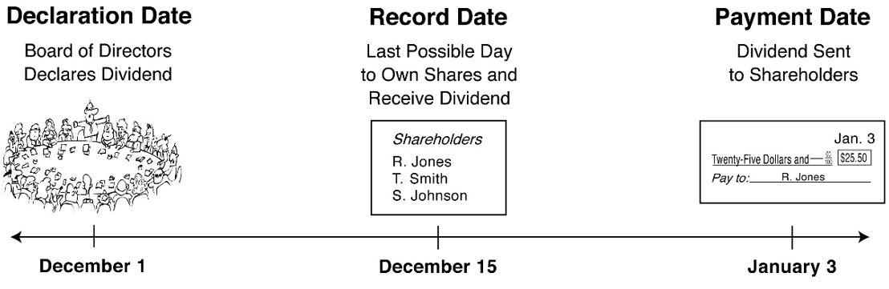
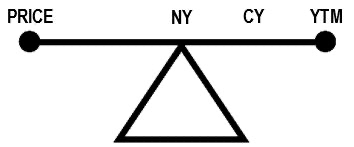

**Dividends**: equity securities make you a part owner - a corporation **MAY** pay out dividends to allow its shareholders to participate in earnings
- The board of directors decide what dividends (if any) it will pay out to common stockholders
- **Declaration date**: the date on which the dividend is authorized, anyone owning a share on the **record date** will be entitled to the dividend
- **Payment date**: The date the dividend is actually paid out (usually quarterly payments - taxable in year paid)
- **Record date**: The date on which an investor must officially own the stock to be entitled to receive the dividend

**Ex-Dividend Rule**: The SRO (e.g FINRA) sets this date which represents the date the stock starts to trade without its dividend - it is the same date as the record date.
- E.g: if someone buys the stock on or after the date, it will settle in T + 1, so they will not be entitled to a dividend on the payment date
- On the Ex-Dividend date, the stock open price will be reduced by the amount equal to the dividend (rounded up if fractional)
- If a trade is executed before the ex-dividend date and delivered after the record date, it will be marked w a **Due Bill** which creates a liability for the seller to deliver the dividend to the buyer for good delivery
- If using **cash settlement**, the buyer may buy ON the ex-dividend date, the price will be adjusted to include the dividend
- **Stock Dividends**: when a company pays out shares instead of cash for a dividend
	- not taxable until additional shares are sold (must adjust cost basis though)

**Current Yield (Dividend Yield)** = Total Annual Dividend / Current Price

**Return on Bonds** = Coupon Rate * Par value ($1000)
- Regardless of what someone paid, its always based on par value

**Nominal Yield : Same as **coupon rate** - regardless of price paid for the bond
- Doesn't take into account price paid

**Current Yield** = Annual Interest / Current Market Price
- Measures what the investor receives each year based on the current market price
- Buying at a *discount* increases current yield, buying at a *premium* decreases current yield
- Doesn't take into account payment at maturity

**Yield-to-Maturity (YTM)**: Takes into account bonds interest payments PLUS difference in paid price for bond and par value
- Also referred to as *yield* or *basis*
- At a premium -> YTM is lowest, current yield higher, and nominal highest
- At a discount -> YTM is highest, current yield lower, and nominal lowest

**Bond - Yield-to-Call (YTC)**: A bond's yield if it is called early
- If a bond is trading at a discount, the YTC is higher than the YTM
- If a bond is trading a premium (and callable at par), the YTC is lower than the YTM
**Bond - Yield-to-Worst (YTW)**: The worse of a bonds YTM and YTC

**Cost Basis**: Total amount an investor has paid to purchase a security, including commissions and fees.
- Some securities make distributions that increase cost basis due to paying tax on distributions
- The cost basis on death inheritance is market value of security on day of death of previous owner

**Capital Gains**: when an investment is sold for greater than its cost basis
- Held for <=1yr -> short term capital gains (ordinary income rate/marginal tax rate)
- Help for >1yr -> long term capital gains tax (maximum is 20%)

**Capital Losses**: when an investment is sold for less than its cost basis
- used to reduce capital gains, if losses are more than gains, a max of $3000 capital losses can be used to reduce income tax, remaining carries over to future years

**Return of Capital**: return of a part of the original investment, not a taxable event

**Identifying Shares Sold**: If an investor buys the same security multiple times and doesn't choose which shares they are selling, FIFO is used by default by the IRS
- They must say "versus purchase of X date" to pick

**Total Return** = (change in value + investment income) / beginning value
- typically calculated over 1yr, expressed as percentage

**Inflation-Adjusted Rate of Return** = actual return - rate of inflation

**Risk-Free Return**: the return on an investment that is risk free, usually the US T-bill or US treasury note is used for this

**Risk-Adjusted Return**: how much an investment returns in relation to risk assumed to attain it

**Averages/Indexes**: a group of securities
- **Dow Jones Average**: 65 stocks in these categories
	- Dow Jones Industrial Average, which consists of 30 stocks -> most common, blue chip companies that represent the backbone of the US
	- Dow Jones Transportation Average, which consists of 20 stocks
	- Dow Jones Utility Average, which consists of 15 stocks
- **The Standard & Poor’s 500 Index**: the biggest 500 companies in the NYSE and NASDAQ
- **NYSE Composite Index**: Every stock on the NYSE
- **NASDAQ Composite Index**: All of NASDAQ
- **NASDAQ 100**: Top 100 NASDAQ companies
- **The Wilshire Associates Equity Index**: Every stock on the NYSE and NASDAQ
- **The Russel Index**: 2000 small cap companies
- **The Major Market Index**: 20 big cap stocks
- **Debt/Bond Indices**: Barclaus, The Bond Buyer -> track bond market