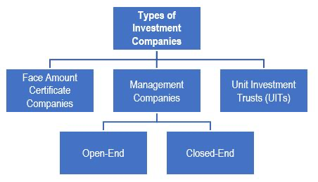
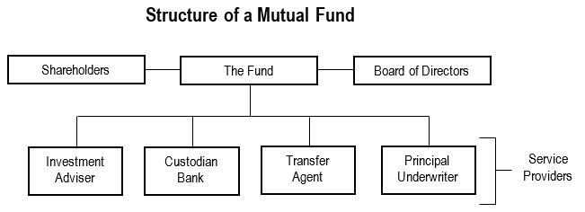
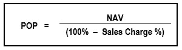

**Open End Management Companies (Mutual Funds)**: For a cost, mutual fund provides a means for investors with similar goals to pool money and invest in a portfolio.
- Board of directors is elected and an expert selects securities and does trades

**Benefits of Mutual Funds**:
- **Diversification**: allows investors to reduce risk by spreading money among different investments
	- To be diversified, 75% of securities must be diversified, meaning:
		- no more than 5% in any single company
		- no more than 10% of voting stock in any one company
	- Fluctuations will not nullify companies diversification status
- **Professional Management**: it is managed professionally by an investment advisor (fund) that has investment adviser representitives (IARs)
- **Liquidity**: extremely liquid
- **Exchanges at Net Asset Value**: You can exchange shares of one fund for shares in another fund under same company for net asset value (fundamental value of shares) for no sales fee
- **Convenience**: money can be automatically taken from checking account, dividends can be reinvested automatically
- **Recordkeeping**: Fund takes care of recordkeeping, sends customers reports and tax forms (1099-DIV). They must send most detailed reports twice a year
- **SEC Registration**: They are registered with the SEC

**The Prospectus**: A funds prospectus include its objective, policies, risks, performance info, staff, operating expenses etc.
- A prospectus must be delivered to the customer with any offer

**Mutual Fund Terminology**    Since mutual fund disclosure documents use specialized language, a list of substitute terms is provided below:
- The sales charge is also referred to as the sales load.
- The net asset value (NAV) is also referred to as the _bid_ or _redemption_
- The public offering price (POP) is also referred to as the _net asset value plus the sales charge_ (if any).

**The Statement of Additional Information (SAI):** not required info but required if requested - has additional info

**Board of Directors**: Elected by shareholders - protect shareholder's interests:
- Establish investment policy
- Determining dividends/capital gains distribution
- Appointing principal officers
- Selecting custodian, transfer agent, underwriter

**Investment Advisor**: Manages funds portfolio with objectives and policies in mind. Do research and pick securities, they are paid a management fee based on AUM

**Custodian Bank**: Maintains funds assets, responsible for safeguarding cash/securities and collecting interest/dividends

**Transfer Agent**: Performs recordkeeping functions like issuing new shares or cancelling shares investors redeem - mostly done electronically
- Also distributed capital gains/dividends to shareholders, forwards documents and reports too

**Principal Underwriter**: Used to sell shares to public. May sell directly or go through dealers to market their funds to investors. 

**Types of Mutual Funds**:
- **Aggressive Growth Funds**: Invest in small companies, IPOs - very volatile but high returns
- **Growth Funds**: Goal of capital appreciation, growth companies
- **Specialized/Sector Funds**: Concentrate investments into particular industry or location - take advantage of unusual situations
- **International and Global Funds**: Focus on foreign securities
- **Equity Income Funds**: High dividend companies
- **Growth and Income Funds**: Balance between growth and equity income
- **Bond Funds**: Focused on bonds only, with income and preservation of capital as goals
- **Index Funds**: Mirrors a benchmark stock or bond index like S&P 500. lower management fees
- **Value Funds**: Invest in out-of-favor companies that are considered undervalued
- **Balanced Funds**: Mix of stocks, bonds, cash, some % in each at all times
- **Asset Allocation Funds**: a balanced fund but fund manager determines percentage
- **Money Market Funds**: Invest in short term debt with maturities <1yr. offers liquidity and safety

**Public Offering Price** (POP) = Net Asset Value (NAV) + Sales Charge
- You buy at POP and sell at NAV

**Net Asset Value** = Total Net Assets / Number of Outstanding Shares
- computed atleast once per day (normally close of NYSE)

Buy and sell orders are computed at next computed price (forward pricing). Transactions typically settle on same day of purchase/redemption. Ex-dividend date is usually business day after record date, determined by fund

**Sales Charge**: Max sales charge is 8.5% (by FINRA rules), but there are bulk discounts

**Back-End Loads/ Contingent Deferred Sales Charge**: Sometimes, funds dont make you pay a sales charge when buying, but they charge it when selling. With a CDSC, the % sales charge decreases the longer you hold the share, sometimes even going to 0.

**No-load fund**: A fund that doesn't assess a sales charge (no front load, deferred load or 12b-1 fee exceeding .25% of funds avg annual net assets)

**12b-1 Charges (Distribution Fees)**: mutual funds may pay for distribution expenses through deductions from the portfolio’s assets
- Deducted from customers account on quarterly basis 
- Max fee is 1% of fund's assets, but can range from .25% to 1%

**Administrative Charges** and **Service Fees** also are part of mutual funds
All fees must be disclosed on prospectus

**Expense Ratio** = Total Expenses / Avg Net Assets (doesn't include sales charges)

**Class A Shares**: Usually have large front-end loads but zero to small 12b-1 charges
- Can take advantage of reduced sales charges through the use of breakpoints or rights of accumulation

**Class B Shares**: Generally no front end sales charges, higher 12b-1 fees are usually assessed
- contingent deferred sales charges (CDSC) if the shares are redeemed before a certain period
- Usually good for 5-7 years, after back end loads is 0, converts to class A
- Class B shares don’t qualify for breakpoint (sales charge) discounts

**Class C Shares**: ongoing fee (typically 1.0%) for as long as the investor holds the shares
- no front end load, back end only if redeemed <1yr.
- good for short term holdings
- 12b-1 fees that are higher than those of Class A shares

**Other Share Classes**: Declared in prospectus

**Reducing Sales Charges**
- **Fund Families**: A investment company that has many different types of mutual funds
- **Breakpoints**: basically a volume discount, reducing front end sales charge if you purchase larger dollar amounts - must be stated on prospectus - quoted price is still the maximum sales charge though
	- Calculating _Offering Price for a Reduced Load_
- **Letter of Intent**: Instead of depositing all the money at once to get breakpoint, investor can promise to deposit it with a LOI. they will deposit the required funds over the next 13 months. The LOI may be backdated for 90 days to include prior purchases. If they don't sales charge will be adjusted and retroactive fees will be charged
- **Rights of Accumulation**: Investors can add up all of the purchases made in the same fund complex. Once a breakpoint is reached, all future purchases are entitled to the reduced sales charge.
	- Applies to:
		- investor
		- family
		- Pension and profit-sharing plans that qualify
		- etc.
- Before mutual fund shares are purchased by a client, an RR must inquire as to whether the client owns other mutual funds within the same fund family in a related account

For a fund to assess the maximum allowable sales charge of 8.5%, it must offer investors both breakpoints and rights of accumulation. If the fund omits either of these features, the maximum sales charge it’s permitted to assess is lowered according to a set schedule.

**Dividend Reinvestment**: When mutual funds pay out dividends, investors can either take them or reinvest them (usually without sales charge, at NAV)

**Dollar cost averaging**: Buying fixed shares of mutual funds periodically, good for long term investors

**Redeeming**: Redemption can be done on any business day, at NAV (NAV is calculated atleast daily)
- Proceeds must come within 7 business days

**Redemption Fees**: .5% - 2% fee when redeeming shares, can be waived if held long enough, separate from any deferred charge that may apply

**Systematic Withdrawal** Plans: Fixed amount, fixed percentage or time period withdrawal plans available

**Prohibited Sales Practices**
- **Breakpoint Sales**: RRs cannot advise to contribute just slightly below a breakpoint to keep investor from getting discounted sales fee - they also can't move money around different funds to avoid breakpoint
- **No Discounts on Class B Shares**: RRs should not recommend buying Class B shares to a client who intends to place a large order. The client should be directed toward Class A shares since only this share class qualifies for breakpoints.
- **Selling Dividends**: prohibited from pressuring clients to immediately purchase mutual fund shares in order to capture an impending dividend. Essentially, there's no economic benefit for a customer since, once the dividend is paid, the fund's NAV will fall
- **Switching Shares**: Can't advise to sell and buy another fund family (another sales charge will be applied)
	- *Exchanging shares* in a single fund family usually doesn't charge sales charge, but still a taxable event
- **Face-Amount Certificate Companies**: issues debt certificates that pay a predetermined rate of interest. Investors purchase these certificates in either periodic installments or by depositing a lump sum and then receive a fixed amount if they hold the certificates until maturity. However, investors who cash in their certificates early will receive a lesser amount_—_referred to as a _surrender value_

