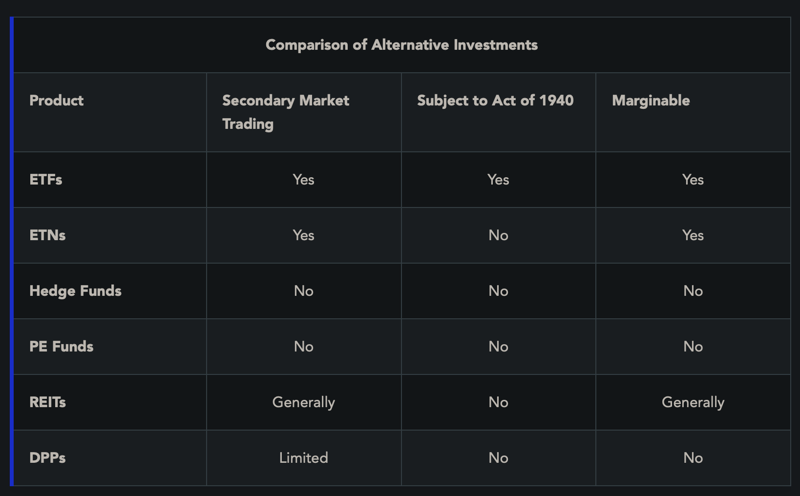

Mutual funds may only be purchased or sold at the end of the trading day

**Exchange-Traded Funds (ETFs)**: Issue shares that represent an interest in an underlying basket of securities that represent some sort of index
- Example: SPDRs (track S&P 500), QQQs (track NASDAQ 100), DIA (track Dow Jones)

**Passive vs Active Management**: Active management refers to a selection of securities by a pro manager to try to outperform market. Passive management refers to simply attempting to match market by tracking index.

**Fee Considerations**: Passive management usually has lower management fees, purchasers of ETF shares pay commissions on their transactions

**ETFs vs Mutual Funds**
- ETFs trade on exchanges and prices are determined by supply v demand
- ETFs have much lower expenses than mutual funds
- ETFs can be sold short and on margin

**Inverse ETFs**: Performs in a manner that is opposite to the index it tracks
- Accomplished by short selling the underlying investments in the index

**Leveraged ETFs**: ETFs that amplify the returns of a specific index
- Can also be inverse leveraged
- Use debt instruments, financial derivatives such as swaps, futures and options to achieve this

Inverse and leveraged ETFs usually reset portfolios daily 
- All price movements are calculated on a % basis for that day ONLY, then it resets daily
- So, it may not provide true tracking of an index in the long term

**Exchange Traded Notes**: unsecured debt security that pays a return which is linked to an underlying market index or other benchmark
- Traded on exchanges with inverse and leveraged versions available
- Don't make interest payments, they pay a holder an amount based on performance of underlying index, maturities of 10-30 yrs
- **High issuer credit risk** since they are unsecured
- **Fees**
	- reference index fees, daily investor fees
	- indicative value = value of index/benchmark - daily investor fee
	- brokerage commission fees

**Hedge Funds**: Private investment pools, not required to register w/ SEC under Investment Compant Act of 1940
- Typically institutional or high net worth investors that understand the risks
- Usually high minimum investment
- Not required to disclose holdings, may use strategies that other more regulated entities (mutual funds) may not use
- Usually generate more return, but more risk too (uses leverage etc)
- They are **Illiquid**. They have restrictions on withdrawals
- They have high and complex fees (such as 2 and 25, 2% management fee and 20% of profits). Mutual funds may not assess sales charge of >8.5% of funds public offering price.

**Private Equity Funds**: Raise capital for start up businesses
- Unregulated and illiquid
- They offer investors limited partnership units that are sold as private placements (under the Reg. D exemption) - no active trading venues

**Real Estate Investment Trusts (REITs)** 
- Portfolio of real estate investments that earn profits. Income earned from rental income paid by tenant
	- May be residential, commercial, office
- Securities Act of 1933 regulates REITs as securities and requires prospectuses be sent to investors who buy shares on public market
- 3 types of REITs
	- **Mortgage REITs**: provide funding to RE purchases by acting like bank
		- Borrow funds from investors, and invest in mortgages, earn income based on difference between the two rates of interest (spread)
	- **Equity REITs**: Own and operate income producing real estate
	- **Hybrid REITs**: Mix of mortgage and equity REITs
- REITs sold under Reg. D as private placements are not listed w/ SEC and are ILLIQUID
- REITs that are registered are exchange traded, have a market value and are liquid

**REITs are TAX advantaged**: REITs avoid paying double taxes on dividends (only taxed at investors level) if 90% of income is distributed to investors

To qualify for the special tax treatment, a REIT must satisfy the following three income tests:
1. At least 95% of its gross income must be derived from dividends, interest, and rents from real property.
2. At least 75% of its gross income must be derived from real property income (e.g., rents or interest).
3. No more than 30% of its gross income may be derived from the sale or disposition of stock or securities that have been held for less than 12 months.

**Direct Participation Program**: Type of investment where results of business venture (cash flow, profits AND losses) directly flow to investors
- We will focus on limited liability companies
- To establish, partnership files a certificate of limited partnership with the state (requires 2 partners, one general and one limited)
- **General Partner (GP)**: responsible for managing program, must contribute >=1% of capital
	- Unlimited liability, fiduciary responsibility to LPs
- **Limited Partner (LP)**: passive, no control over managerial decisions, large amount of capital
	- If they take on active role in management, then they must be considered GPs
	- Has the right to:
		- Lend to the partnership
		- Inspect books
		- Compete

**Advantages of LPs**:
- **Tax Advantages**: corporations are taxed twice (on their income + shareholders pay on dividends). LPs income flows directly to investors, so only taxed as income tax once
	- 20% of the income that’s passed through by partnerships is deductible (excluded from tax).
	- The maximum tax rate on ordinary income has been lowered to 37% (from 39.6%).
- **Limited Liability**: Assume financial risk only to extent of their investment
- **Diversification**: Many LPs invest in a variety of assets

**Disadvantages of LPs**:
- **Lack of Control**: No managerial authority
- **Illiquidity**: No market for LPs and must obtain permission of GP to sell
- **Tax Issues**: Complicated tax filing, fragile tax code usage
- **Possible Capital Call**: May be asked to contribute additional funds, if not could be forced to forfeit interest

**DPP Offering Practices**: May be either public or private securities offering
- For public offerings, underwriter is hired and DPP's interests are registered with SEC, prospectus is offered -> DPP interests are generally illiquid since theyre not traded (unlisted)
- GP must accept purchaser to be valid
- Max compensation for underwriter is 10% of gross dollar amount of securities being sold
- In private offerings, under regulation D, they are exempt from registration. Disclosure if provided through offering memorandum

**Passive Activities**: investments in which an owner of a business doesn’t materially participate in its operations throughout the year
- Losses generated by passive activities can only be subtracted from income from passive activities (excess passive losses can be carried forward to future years)
- When ownership interest is sold, owner can deduct all passive losses from any income

**Real Estate Limited Partnerships**
- **Raw Land**: LPs may purchase large tracts of raw land for purposes of speculation
	- No depreciation deductions, no period income, just speculation of value
- **New Construction**: Generally, objective is capital appreciation but also cash flow from leases
- **Existing Properties**: Purchases existing commercial properties
	- Immediate cash flow from rentals/leases and depreciation allowances
- **Government Assisted Housing**: projects
	- Provided tax credits for costs associated with construction of low income housing

**Oil and Gas Limited Partnerships**
- **Exploratory Program**: Wildcatting, searching for oil/gas in unproven areas
	- High risk
- **Developmental Program**: Leases are acquired for the right to drill in proven areas
	- lower risk, lower potential return
- **Balanced Program**: Combination of both exploratory and developmental
- **Income Program**: Acquires interests in already producing wells
	- Lower risk, lower return

DPPs/LPs are RISKY

Before executing sale, RR is required to certify that customer is informed about lack of marketability and liquidity of LPs and they must pass net worth and income tests to withstand potential loss of entire investment

**RRs MAY NOT exercise DISCRETION when recommending a DPP**
